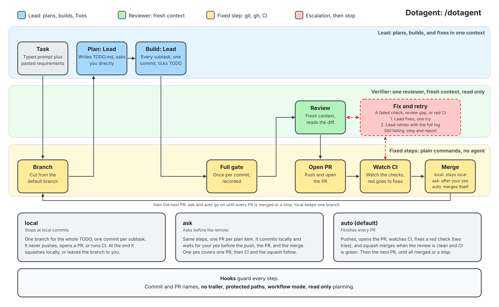

# dotagent

🚢 A **minimalist agent swarm workflow** for Claude Code that gets the job done: **clear requirements in, clean pull request out, merge, and ship.**

New skills and plugins show up every week, and most of us feel it: you install five skills, forget what
each does, the setup gets heavier than the work, so you end up overwhelmed. 
So I made my own, *small on purpose*, built on engineering habits I trust. I want to share it, but it only 
works once you adapt it to your
repo. The generic parts are here, the parts that depend on your code are yours to fill in.

- Small on purpose: a few skills, three agents, one hook script, one config file.
- Habits behind each rule are listed in `docs/PRACTICES.md`, so you can judge which to keep.



## what it is for

- Shipping when the requirements are **already clear**: like you have sprint planning from the product team, a clear scope, and a defined set of acceptance criteria, and you're ready to implement.
- **Not for** ideation, diagrams, or exploring a codebase. Use other skills for that and bring the result here.

## prerequisites

- [Claude Code](https://code.claude.com) (recent) and `git`
- [GitHub CLI](https://cli.github.com), signed in
- [Python](https://www.python.org/downloads/) 3.8 or newer (runs the hooks; `python3`, `python`, or `py` all work)
- on Windows, [Git for Windows](https://gitforwindows.org) (Claude Code needs it, and the hooks run through its `sh`)

## install

Pick one path. Both write the same files and the same `.dotagent/config.json`.

### with the plugin (easier to set up, needs claude code)

```bash
claude
/plugin marketplace add raihanpka/dotagent
/plugin install dotagent@dotagent
/dotagent:setup     # once per repo
```

- `/dotagent:setup` runs once. It reads your repo, then interviews you in rounds like [grill-me](https://www.aihero.dev/skills-grill-me), with a recommended answer per question (if you are unsure, for example about the architecture, it describes what your code already shows in an established repo, and recommends a simple best practice only in a new one): commands, architecture and coupling, scale, merge level, commit scopes, CI, git hooks.
- It shows each file before writing it, then ends with `docs/DOTAGENT-SETUP.md`, a checklist to tick as you review the setup.
- See `examples/` for the output.

### by hand (easier to set up, but no plugin)

Copy from `plugin/` and edit. Fill every `{{...}}`. `plugin/SETUP.md` lists the questions worth answering.

| Copy from `plugin/` | To your repo | Edit |
|---|---|---|
| `templates/AGENTS.md` (and `AGENTS.md`, the generic rules) | `AGENTS.md` | commands, modules, scopes |
| `templates/CLAUDE.md` | `CLAUDE.md` | nothing |
| `templates/.dotagent/config.json` | `.dotagent/config.json` | scale, merge, and the rest |
| `hooks/guard.py`, `hooks/run.sh` | `.dotagent/` | nothing |
| `templates/.claude/settings.json` | `.claude/settings.json` | nothing |
| `templates/.github/PULL_REQUEST_TEMPLATE.md`, `PR_EXAMPLE.md` | `.github/` | the check commands |
| `templates/.github/workflows/ci-pr.yml`, `ci-default.yml` | `.github/workflows/` | setup step, commands |
| `templates/.githooks/` | `.githooks/` | then `git config core.hooksPath .githooks` |
| `templates/docs/` (`README.md`, `ARCHITECTURE.md`, `CONVENTIONS.md`, `DOTAGENT-SETUP.md`, `TODO.md`) | `docs/` | architecture, conventions |

`plugin/templates/` mirrors your repo path for path, so what setup writes is what you copy. `docs/TODO.md` is the planner's layout, copy it only to read it.

- Hooks for the manual path only (the plugin brings its own): merge this into `.claude/settings.json`.

```json
{
  "hooks": {
    "SessionStart": [{ "hooks": [{ "type": "command", "command": "sh .dotagent/run.sh" }] }],
    "PreToolUse": [{ "matcher": "Bash|Write|Edit|Read", "hooks": [{ "type": "command", "command": "sh .dotagent/run.sh" }] }]
  }
}
```

- Add `.dotagent`, `.claude`, `docs/DOTAGENT-SETUP.md`, and `docs/TODO.md` to your `.gitignore`, the plugin path does it for you.
- Without Claude Code, the files above and the git hooks still work. The agents and `.claude` hooks need it.

## how to use it

| Command | What it does |
|---|---|
| `/dotagent <task>` | Ship the task with your saved settings. Same as `/dotagent:ship`. |
| `/dotagent:ship [small\|medium\|large] <task>` | Ship the task. The scale word applies to this run only. |
| `/dotagent:scale small\|medium\|large` | Save the default scale. No argument shows the settings. |
| `/dotagent:merge off\|on-green\|full` | Save the merge level. No argument shows the settings. |
| `/dotagent:setup` | Set dotagent up in this repo, once. |

In the `/` menu the commands appear as `/dotagent:dotagent`, `/dotagent:ship`, `/dotagent:scale`, `/dotagent:merge`, and `/dotagent:setup`, and the bare `/dotagent` also runs the first one.

```
/dotagent add the billing endpoint. requirements from product: <paste them>
/dotagent:ship large add the billing endpoint. requirements: <paste them>
/dotagent fix the grpc connection from backend to the agents in python
```

- Everything after the command is the task, pasted requirements included.
- Say *plan only* to stop after the plan and read `docs/TODO.md`.
- A big task becomes several PRs and one run ships all of them, in order, until everything is merged or something stops it.
- To go on after a stop, say `continue` in plain words, or run `/dotagent:ship` with no task. With a new task while an old one is unfinished, it asks you first whether to finish the old one (recommended) or drop it.

### scale

| Scale | For | What happens |
|---|---|---|
| `small` | a tiny diff | No plan. Change, check, commit, PR. |
| `medium` *(default)* | most features | Planner writes the PRs, one Haiku worker per subtask, reviewer, PR. |
| `large` | many modules, a team, unattended | The `ship-large` workflow runs the same steps with the limits enforced in code. *Not yet tried on a big repo. Falls back to `medium` without the Workflow tool.* |

### settings

One file, `.dotagent/config.json`, local and ignored by git (setup adds `.dotagent`, `.claude`, `docs/DOTAGENT-SETUP.md`, and `docs/TODO.md` to your `.gitignore`, so nothing of dotagent shows up in your repo).

| Key | Default | Values |
|---|---|---|
| `scale` | `medium` | `small`, `medium`, `large` |
| `merge` | `on-green` | `on-green`, `off`, `full` |
| `em_dash` | `block` | `block`, `allow` (set `allow` only when you want em dashes) |
| `emoji` | `block` | `block`, `allow` (set `allow` only when you want emoji) |
| `style_skills` | `none` | comma separated skills, such as `caveman,ponytail:lite` |
| `protected` | empty | comma separated globs no agent may edit, such as `db/migrations/**,.github/CODEOWNERS`. A hook refuses the edit. Set it with `sh hooks/run.sh set protected "<globs>"` |

- Change `scale` and `merge` with the commands above. Any key: `sh run.sh set <key> <value>`, or edit the file.
- A missing file or key means the default. A wrong value or a broken file means `merge` off, so a typo never turns merging on.
- The agent cannot edit this file, only you can.

### how a run works

- **Task, PR, subtask:** the planner turns your task into one or more PRs, and each PR into subtasks (edit this file, add that test). One run goes through every PR by itself.
- **Plan first, read only:** the planner reads the repo and writes only `docs/TODO.md`. A hook refuses any other write, `git commit`, and `git push` until the plan is settled. It does not use Claude Code plan mode, which would block the TODO.
- **Nothing gets lost between PRs:** with several requirements the planner numbers them `R1`, `R2`, and each PR says what it `covers`. The reviewer checks those, and an uncovered one comes back as a question.
- **Ambiguity is asked, never guessed:** the planner hands back each open question with options and a recommended answer plus the reason. You agree or choose, and it plans again until nothing is open.
- **`docs/TODO.md` is the report:** each Haiku worker ticks its own subtask when it finishes. A new task replaces the file. It is ignored by git, so nobody has to be shy about it.
- **Team:** Sonnet plans and reviews. Haiku workers build, one subagent per subtask, one at a time. Git, `gh`, and CI are plain commands.
- **Size is a range, not a limit:** a PR is reviewable in one sitting, usually 3 to 8 subtasks and a few hundred changed lines. A bigger task becomes more PRs.
- **Fixes:** a failure gets one Haiku try, then one Sonnet try, then it stops and reports.
- **Merge levels:** `on-green` (default, merge when the review is clean and CI is green), `full` (also fixes review gaps itself), `off` (stop at the open PR). Always a squash merge, and never `--admin`. The squash body lists every commit with its hash, so the atomic commits stay traceable.
- **Git hooks are part of setup:** setup writes `pre-commit`, `commit-msg`, and `pre-push` and turns them on (`git config core.hooksPath .githooks`). They check every commit and push by anyone, the agent, a person, or a script, which the agent hook cannot. Every run and every new session checks they are still on, and warns when the repo ships them but git does not use them.
- **Format and lint before CI:** the `pre-commit` git hook checks format and lint, `pre-push` runs format, lint, build, and test, and the worker formats before it commits. A red CI is then a real failure, not a forgotten lint.
- **Continue:** `docs/TODO.md` and git are the state. A new session announces unfinished work, so `continue` resumes where it stopped.
- **Hooks, not prompts, enforce:**
  - one-line `type(scope): summary` commits with no trailer
  - the PR title format and the merge level, and the merge is a squash whose subject ends with this PR's `(#N)` (a commit or PR title never writes it, GitHub adds it) and whose body is only `- <hash> <subject>` lines. A merge commit and a rebase are refused
  - **names say what changed, never where the work sits in the plan:** no `milestone-1`, `task-2`, `slice 3`, `wip`, or "finishing task" in a commit, PR title, or merge subject. `feat(auth): add the login route`, never `feat(milestone-1): add login`
  - no em dash or emoji, unless you set them to `allow` (see Settings)
  - no `Co-Authored-By` trailer and no "Generated with" line in a commit, the PR body, or the squash body. A PR whose commits already carry one is not merged
  - no `--no-verify` on `git commit` or `git push`, so the git hooks always run
  - no whole read of a file over 500 lines
  - while building, no edit outside the PR's `files:` list in `docs/TODO.md`, and none in a `protected` path
  - a receipt: `sh hooks/run.sh receipt` prints which subagents really ran (`planner 1, worker 4, reviewer 1`)

## skills i use around it

- [`idea-refine`](https://github.com/addyosmani/agent-skills/tree/main/skills/idea-refine) to shape
an idea, other skills for diagrams or exploring. 
- List style skills like `caveman` or `ponytail:lite` in `style_skills`. 
- The planner and worker already carry the fitting parts of [`planning-and-task-breakdown`](https://github.com/addyosmani/agent-skills/tree/main/skills/planning-and-task-breakdown) and [`incremental-implementation`](https://github.com/addyosmani/agent-skills/tree/main/skills/incremental-implementation), so those are not companions.

## structure

```
dotagent/
├── .claude-plugin/marketplace.json   # points at plugin/, only plugin/ is downloaded
├── plugin/                           # everything that installs
│   ├── SETUP.md  AGENTS.md           # setup interview, generic working rules
│   ├── hooks/  agents/  skills/      # guard.py, planner/worker/reviewer, dotagent ship scale merge setup
│   ├── workflows/                    # ship-large.js
│   └── templates/                    # mirrors a repo 1:1: .github, .claude, .githooks, .dotagent, docs
├── examples/                         # what setup generated for a real repo
├── CHANGELOG.md                      # versions, set only in plugin.json
├── scripts/release-notes.sh          # release notes: the CHANGELOG section plus the commits since the last tag
├── .github/workflows/release.yml     # tags and releases a version when it is bumped on main
├── docs/                             # PRACTICES.md, BENCHMARK.md, workflow diagram (svg, excalidraw)
└── tests/                            # hook tests, workflow tests
```

`docs/PRACTICES.md` says where each rule comes from, `docs/BENCHMARK.md` is the plan to measure it. After a
change run `bash tests/hooks.test.sh` and `node --test tests/ship.test.mjs`.

To release: bump `version` in `plugin/.claude-plugin/plugin.json`, add a `## <version>` section to `CHANGELOG.md`, and push to `main`. The release workflow runs the tests, tags `v<version>`, and publishes the release with that section and the commits since the last tag.

## known gaps or bugs?

- Built for my own workflow.
- Tried on small tasks, not yet on a big repo. `large` (the `ship-large` workflow) most of all.
- Tried on Windows and macOS, Python comes from the device.
- Found something? Open an issue.

## credits

- [Lauren Tan, How I Shipped 2000 PRs Last Month](https://youtu.be/NjoZoUm85x0)
- [Stripe, Minions](https://stripe.dev/blog/minions-stripes-one-shot-end-to-end-coding-agents)
- [Spotify, Portal cut Claude Code token usage by 90 percent](https://engineering.atspotify.com/2026/9/portal-by-spotify-cut-my-claude-code-token-usage-by-90)
- [Addy Osmani, agent-skills](https://github.com/addyosmani/agent-skills)
- [caveman](https://github.com/JuliusBrussee/caveman) and [ponytail](https://github.com/DietrichGebert/ponytail)
- The Claude Code docs, and the rest listed in `docs/PRACTICES.md`
