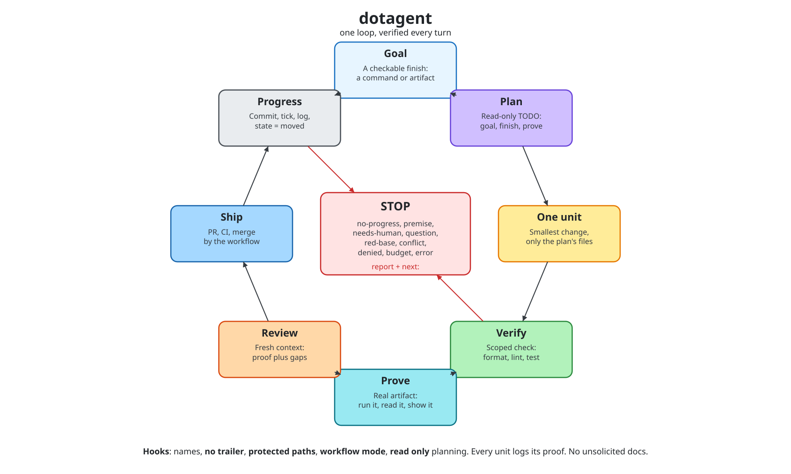

# dotagent

A **small agent loop that verifies its own work**: clear requirements in, one verified unit at a time, a proof against the real artifact,
a fresh review, and a stop reason when it cannot move. It ships as a Claude Code plugin, a Codex plugin, and an Agent Skill that Command
Code, Cursor, Antigravity, and any agent that reads `.agents/skills` can run.

The point is not more throughput. It is a loop you can trust to run for a long time without getting stuck: every turn either advances or
ends with one reason you can act on. A green build is not a green feature, so the loop proves behavior before it reports done.



## what it is for

- Shipping when the requirements are **already clear**: a sprint scope, acceptance criteria, a bug with a repro.
- **Not for** ideation, diagrams, or exploring a codebase. Use other skills for that and bring the result here.
- Small on purpose: five commands, one subagent (the reviewer), one guard hook, one config file, four references.

## install

| Agent | Install | Run |
|---|---|---|
| **Claude Code** | `/plugin marketplace add raihanpka/dotagent`, then `/plugin install dotagent@dotagent` | `/dotagent:setup`, then `/dotagent:ship <task>` |
| **Codex** | `codex plugin marketplace add raihanpka/dotagent`, install from `/plugins`, then trust its hooks in `/hooks` | `/dotagent:setup`, then `$dotagent-ship <task>` |
| **Command Code** | `cmd skills add raihanpka/dotagent -s dotagent-ship` | `/dotagent-ship <task>`, or `/skill:dotagent-ship <task>` |
| **Cursor, Antigravity, other** | `npx skills add raihanpka/dotagent --skill dotagent-ship -a codex -a antigravity-cli -y`, or copy `skills/dotagent-ship/` into `.agents/skills/` | `/dotagent-ship <task>` |

Command Code and the other agents copy the portable skill. Run the setup guide once so the repo also gets `AGENTS.md`, the guard, the git
hooks, and the verification map:

```
Set up dotagent in this repo by following the instructions here:
https://raw.githubusercontent.com/raihanpka/dotagent/main/docs/SETUP-AGENT.md
```

- `/dotagent:setup` (Claude Code) or the guide above reads the repo and asks one short round: which agent, the commands, the workflow, and
  whether the repo needs a verification map or a formal property.
- It shows every file before writing it, never overwrites an existing one, and ends with `docs/DOTAGENT-SETUP.md`, a checklist to tick.
- Skip setup and `/dotagent:ship <task>` still works. The first run says which defaults it uses and asks once whether to set up first or
  go on with only a TODO.

## use

| Command | What it does |
|---|---|
| `/dotagent <task>` | The short form of `/dotagent:ship`. Alone it prints the run state and the next step. |
| `/dotagent:ship <task>` | Run the task as one loop. `continue` resumes from the recorded state. |
| `/dotagent:workflow local\|ask\|auto` | Save how far a run goes on its own, for every run. |
| `/dotagent:setup` | Set dotagent up in this repo, once. Claude Code, Codex, Command Code, both, or another. |
| `/dotagent:review [<pr>]` | With a PR: review it and post only what you choose. With no argument: review the unfinished work of this repo. |

```
/dotagent add the billing endpoint. requirements from product: <paste them>
/dotagent:ship fix the board leak. repro first, then fix and prove it.
/dotagent status
/dotagent:ship continue
```

- Everything after the command is the task, pasted requirements included. Say `plan only` to stop after the plan.
- A big task becomes several PRs and one run ships all of them in order. To go on after a stop, say `continue`.
- Each new session, `/clear`, and compact prints one line with the run state: `phase`, `left`, `stop`, `stalled`, `next`.

### workflow

How far a run goes on its own.

| Mode | What happens |
|---|---|
| `auto` *(default)* | Runs the whole TODO and finishes every PR: pushes, opens the PR, watches CI, fixes a red check (two tries), rebases, squash merges when the review is clean and CI is green, then starts the next PR. It stops on a failure, a stop reason, or a PR that cannot merge. |
| `ask` | The same run and local commits, but it asks for your yes in the chat before any push, PR, or merge. |
| `local` | Asks first, sets up the minimum, puts the whole TODO on one local branch, never pushes. |

Codex and Command Code cannot show a permission prompt, so `ask` refuses every push, PR, and merge there. Use `auto` or `local`.

### settings

One file, `.dotagent/config.json`, per machine and ignored by git (written by `run.sh set`).

| Key | Default | Values |
|---|---|---|
| `workflow` | `auto` | `auto`, `ask`, `local` |
| `agents` | unset | `claude`, `codex`, `commandcode`, `both`, `other` |
| `merge_method` | `squash` | `squash`, `merge`, `rebase` |
| `commit_types`, `commit_scope` | the default list, `required` | a comma separated list, and `optional` when the repo writes `feat: add x` |
| `base_branch` | the default branch | the branch PRs target, such as `develop` |
| `em_dash`, `emoji` | `block` | `block`, `allow` |
| `style_skills` | `none` | comma separated skills, such as `caveman,ponytail:lite` |
| `protected` | empty | globs no agent may edit, such as `db/migrations/**,.github/CODEOWNERS` |
| `setup`, `hooks` | unset | answers you gave once, saved so they are not asked twice |

- `/dotagent:workflow` sets the mode. Any key: `sh hooks/run.sh set <key> <value>`.
- A missing key means the default. A wrong value or a broken file means `local`, so a typo never turns pushing on.
- The agent cannot edit this file, only you can.

## how the loop works

1. **Goal and finish.** `docs/TODO.md` starts with `goal:`, `finish:` (a command or artifact that can pass or fail), and an optional
   `budget:`. A run is done when the predicate passes, not when the TODO looks empty.
2. **Plan, read only.** If the diff fits one sentence there is no plan. Otherwise the lead writes the TODO: one section per PR, each with
   `files:`, `prove:`, 3 to 8 subtasks, and a `Verify:` command per subtask. Open points are decided with a reason, not asked.
3. **One unit.** The smallest change, only the planned files, one scoped check, one commit, one tick, one `## log` row. Nothing waits
   between units.
4. **Verify, then prove.** The scoped check proves the case; the `prove:` command drives the real artifact. Formal verification is the
   next rung when tests cannot reach the case: TLA+ for interleavings, a code-level verifier for every-input properties, a proof assistant
   when a bound is not enough. `docs/VERIFICATION.md` records the property, the tool, the covered code, and the sync commit.
5. **Review in a fresh context.** The `reviewer` checks the diff and the proof: a `prove:` with no resolving evidence, a behavior change
   proved only by the gate, a weakened test, a new markdown file nobody asked for, a comment that restates the next line, or a formal check
   that did not rerun.
6. **Ship.** PR, CI, rebase, squash merge. The gate runs once per commit and is recorded.
7. **Progress.** `run.sh progress` records HEAD and the unfinished count. `moved` goes on. `same` gets one different approach. Two `same`
   rows in a row is a stall, and a stall is a stop, not another try.

### the stop contract

Every stop names one reason, writes it to `.dotagent/runs.jsonl`, writes a `## stopped` block in the TODO, and ends with a `next:` line.
That is what keeps a long run from getting stuck: it either advances or it stops with something you can act on.

| Reason | Fires when |
|---|---|
| `done` | The `finish:` predicate passes |
| `no-progress` | Two units moved neither HEAD nor the unfinished count |
| `premise` | Two fixes that share one premise failed the same check |
| `needs-human` | An irreversible action, a secret, or a user-only call blocks the next unit |
| `question` | The requirement contradicts itself or the repo |
| `red-base` | The gate fails on resume or on the base branch |
| `conflict` | A rebase conflict survives two tries |
| `denied` | The workflow mode or a permission prompt refused a push, PR, or merge |
| `budget` | The unit, turn, or time budget is spent |
| `error` | A tool or CLI failed twice |

For a long plan, `sh hooks/loop.sh` runs one fresh process per PR. It reads the state first, stops on a recorded stop or a stall, and
compares HEAD and the unfinished count after each PR. `CLAUDE_FLAGS="--max-turns 40"` or `CLAUDE_FLAGS="--max-budget-usd 5"` caps each
process. The state, the TODO, git, and `gh` are the record, so a crash loses the context, not the work.

## what the hooks enforce

- one-line `type(scope): summary` commits, and names that say what changed, never `milestone-1`, `task-2`, `wip`, or `(#N)`
- no `Co-Authored-By` or "Generated with" trailer in a commit, the PR body, or the squash body
- no em dash or emoji unless you set `allow`, no `--no-verify`, no `--force` (only `--force-with-lease`), no `--admin`
- push, PR, and merge follow the workflow: `ask` asks first, `local` refuses
- while building, an edit outside the PR's `files:` is refused until the path is added to `docs/TODO.md` with a reason, and a
  `protected` path is never edited
- the guard runs in Claude Code, Codex, and Command Code; other agents get the git hooks and CI

## structure

```
dotagent/
├── .claude-plugin/marketplace.json   # points at plugin/, only plugin/ is downloaded
├── plugin/                           # everything that installs
│   ├── SETUP.md  SETUP-REFERENCE.md  # the short setup guide, and the details it reads on demand
│   ├── hooks/  agents/  skills/      # guard.py, loop.sh, reviewer, ship (core + 4 references), workflow, setup, review
│   └── templates/                    # mirrors a repo 1:1: .github, .claude, .codex, .commandcode, .githooks, .dotagent, docs
├── skills/dotagent-ship/             # the portable skill, byte identical to the template copy
├── hooks/hooks.json                  # the Codex hook entry
├── examples/                         # what setup generated for a real repo
├── scripts/                          # release notes, and the diagram renderer
├── docs/                             # PRACTICES.md, the loop diagram (svg, excalidraw), SETUP-AGENT.md
├── CHANGELOG.md                      # versions, set only in plugin.json
└── tests/                            # hook tests, skill tests
```

`docs/PRACTICES.md` says where each rule comes from. After a change run:

```
bash tests/hooks.test.sh
node --test tests/ship.test.mjs tests/skills.test.mjs tests/marketplace.test.mjs
python3 scripts/workflow-svg.py --check
```

To release: bump `version` in `plugin/.claude-plugin/plugin.json` and `.codex-plugin/plugin.json`, add a `## <version>` section to
`CHANGELOG.md`, and push to `main`. The release workflow runs the tests, tags `v<version>`, and publishes the release.

## known gaps

- Built for my own workflow. The guard is Python 3.8 or newer, so Claude Code, Codex, and Command Code need it on the machine.
- The gate record is bookkeeping the agent trusts. CI is the real check, and the proof is what the reviewer reads.
- `examples/` was written from the templates by hand. Setup is an interview and was not run again on it.
- Cursor, Antigravity, and other agents get the portable skill, the git hooks, and CI, but not the guard hook.
- Tried on Windows and macOS. Found something? Open an issue.

## credits

- [Lauren Tan, How I Shipped 2000 PRs Last Month](https://youtu.be/NjoZoUm85x0), and the pstack skills in
  [cursor/plugins](https://github.com/cursor/plugins/tree/main/pstack/skills): the trust pyramid, the stop-or-advance loop, the decision
  log, and "prove it works".
- [Stripe, Minions](https://stripe.dev/blog/minions-stripes-one-shot-end-to-end-coding-agents)
- [Spotify, Portal cut Claude Code token usage by 90 percent](https://engineering.atspotify.com/2026/9/portal-by-spotify-cut-my-claude-code-token-usage-by-90)
- [Addy Osmani, agent-skills](https://github.com/addyosmani/agent-skills)
- [caveman](https://github.com/JuliusBrussee/caveman) and [ponytail](https://github.com/DietrichGebert/ponytail)
- The Anthropic posts on long running harnesses, context engineering, and folding subagents into the main loop, plus the rest listed in
  `docs/PRACTICES.md`.
