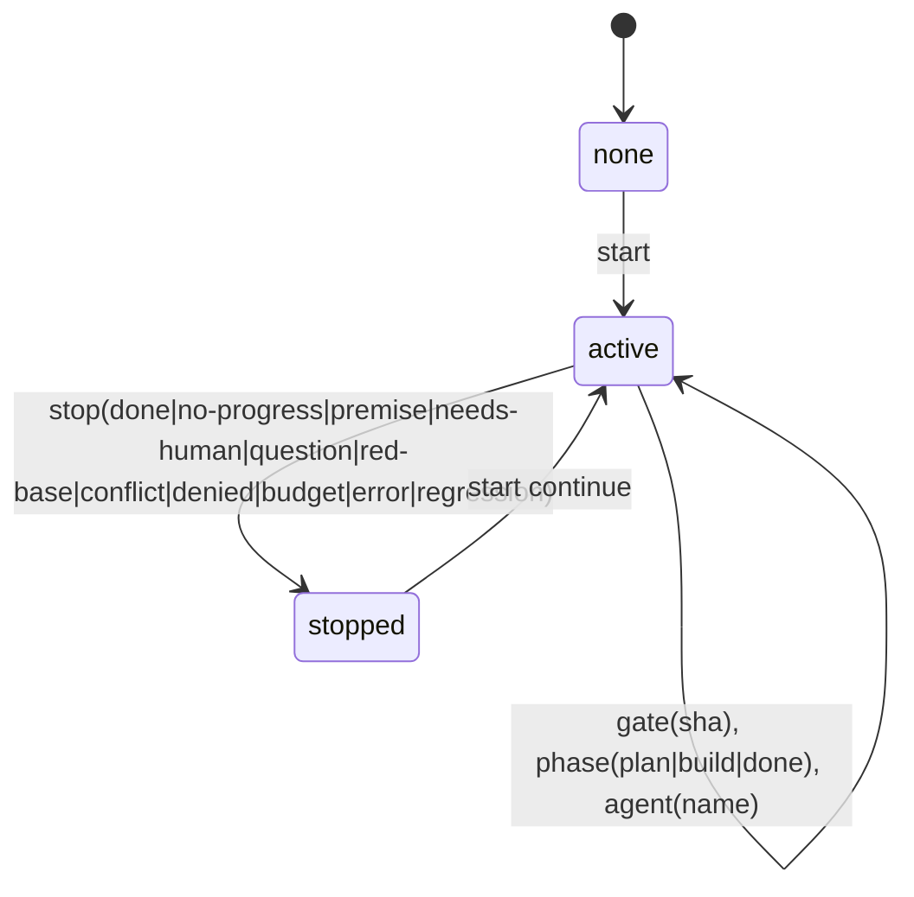

# The dotagent state and logs

A run has two records. `docs/TODO.md` is for the human: the goal, the finish predicate, the plan, the `## log` table, and the
`## stopped` block. `.dotagent/runs.jsonl` is for the machine: one append-only event per state change. Neither is a transcript, and
neither is committed.

`.dotagent/` is local to the machine. `run.sh set` adds it to `.git/info/exclude`, never `.gitignore`, so it does not show in a diff and
does not travel with a clone.

## Files

| Path | What it is | Who writes it |
|---|---|---|
| `.dotagent/config.json` | The saved settings: `workflow`, `agents`, `merge_method`, `commit_types`, `commit_scope`, `base_branch`, `em_dash`, `emoji`, `style_skills`, `protected`, `setup`, `hooks`. | Only `run.sh set`, never the agent by hand. |
| `.dotagent/runs.jsonl` | One JSON object per line, oldest first. Append-only during a run. | The guard, through `start`, `progress`, `stop`, `gate`, `phase`, and subagent spawns. |

A missing file means the defaults. A broken JSON file means `workflow=local`, so a typo never turns pushing on.

## What setup generates

Only these files live under `.dotagent/`. Everything else the setup writes (`AGENTS.md`, `docs/TODO.md`, `docs/VERIFICATION.md`, the PR
template, CI, the git hooks) stays outside it.

| Path | Generated by | When | Contents |
|---|---|---|---|
| `.dotagent/config.json` | `sh run.sh set <key> <value>`, or setup | always | The saved settings. Sparse: only the keys the user set. |
| `.dotagent/run.sh` | setup, from `plugin/hooks/run.sh` | `codex`, `commandcode`, `other` | The shell entry that finds Python 3.8 or newer and runs `guard.py`. |
| `.dotagent/guard.py` | setup, from `plugin/hooks/guard.py` | `codex`, `commandcode`, `other` | The hook and its CLI: `state`, `log`, `start`, `progress`, `stop`, `gate`, `phase`, and `set`. |
| `.dotagent/runs.jsonl` | the guard at runtime | first `state`, `start`, `progress`, `stop`, `gate`, `phase`, or subagent spawn | The append-only machine log. |

For Claude Code the plugin already ships `run.sh` and `guard.py`, so setup writes only `config.json`; `runs.jsonl` appears on the first
guard call. The `.commandcode/settings.json` and `.codex/hooks.json` files point at `.dotagent/run.sh` with `--client commandcode` or
`--client codex`.

The `config.json` shape, with the defaults a missing key takes:

```json
{
  "workflow": "auto",
  "agents": "commandcode",
  "merge_method": "squash",
  "commit_types": "feat,fix,hotfix,docs,style,refactor,test,chore,perf,revert,ci,build",
  "commit_scope": "required",
  "base_branch": "main",
  "em_dash": "block",
  "emoji": "block",
  "style_skills": "none",
  "protected": "db/migrations/**,go.sum",
  "setup": "full",
  "hooks": "on"
}
```

- `workflow`: `auto` or `local`. Default `auto`.
- `agents`: `claude`, `codex`, `commandcode`, `both`, or `other`. Unset until setup.
- `merge_method`: `squash`, `merge`, or `rebase`. Default `squash`.
- `commit_types`: a comma separated lowercase list. `commit_scope`: `required` or `optional`.
- `base_branch`: the branch PRs target. Empty means the repo default.
- `em_dash`, `emoji`: `block` or `allow`.
- `style_skills`: comma separated skill names, or `none`.
- `protected`: comma separated globs no agent may edit.
- `setup`: `full`, `minimal`, or `skipped`. `hooks`: `on` or `declined`.

`runs.jsonl` holds one event per line. The full event table is below; the shortest real file looks like this:

```json
{"t":1767225600,"start":"fix the board leak","head":"1a2b3c4"}
{"t":1767225900,"progress":"2.1","head":"5d6e7f8","left":1,"changed":true}
{"t":1767226200,"stop":"no-progress","detail":"four same rows after one pivot"}
```

## Events

Every event has `t`, the Unix time in seconds. The rest of the shape depends on the event.

| Event | Fields | Meaning |
|---|---|---|
| `start` | `start` (the goal), `head` (the commit, or empty) | A new run, or `continue` after a stop. The newest `start` begins the current run. |
| `progress` | `progress` (the unit), `head`, `left`, `changed` | One unit was recorded. `changed` is true when HEAD moved or the unfinished count dropped. |
| `stop` | `stop` (the reason), `detail` | The run ended for a named reason. |
| `gate` | `gate` (the commit sha) | The full gate passed at that commit. Only the newest is kept at session start. |
| `phase` | `phase` (`plan`, `build`, `done`) | The read-only planning marker. It expires after an hour. |
| `agent` | `agent` (the subagent name) | A subagent spawn, for the receipt. Spawns belong to one session. |

Example lines:

```json
{"t":1767225600,"start":"fix the board leak","head":"1a2b3c4"}
{"t":1767225900,"progress":"2.1","head":"5d6e7f8","left":1,"changed":true}
{"t":1767226200,"stop":"no-progress","detail":"four same rows after one pivot"}
```

## The state machine



- `run=none`: no `start` yet, or no run in this repo.
- `run=active`: the newest `start` has no later `stop`.
- `run=stopped`: the newest event is a `stop`. A `progress` does not clear it; only a new `start` does. A stop recorded before a start stays
  visible, so a process that dies before it begins still leaves the reason.
- `same=N`: N consecutive `progress` rows that moved neither HEAD nor the unfinished count. Two is a pivot. Four is `stalled=yes` and a
  `no-progress` stop.
- `phase=plan`: the read-only planning marker. It is separate from `run` and expires after an hour.

## The capsule

`sh run.sh state` prints one line:

```
run=active reason=- phase=build left=2 head=1a2b3c4 progress=5 same=1 stalled=no next="feat(api): filter the list"
```

`sh run.sh status` prints only the unfinished count, for `loop.sh`. The session start prints the same capsule plus the saved settings and the
unfinished count.

## Commands

| Command | What it does |
|---|---|
| `run.sh state` | The capsule above. |
| `run.sh start <goal>` | Start a run, or `start continue` to clear a stop. |
| `run.sh progress <unit>` | Record one unit. Prints `moved` or `same`. Refuses while stopped. |
| `run.sh stop <reason> <detail>` | End the run with one reason. |
| `run.sh status` | The unfinished count. |
| `run.sh log` | The `## log` table as TSV: `when`, `unit`, `decision`, `evidence`, `result`. |
| `run.sh gate run <command>` / `gate check` | Run the full gate and record the commit, or check the record. |
| `run.sh phase plan\|build\|done` | The read-only planning marker. |
| `run.sh receipt` | The subagents that ran in this session. |
| `run.sh show` | Every saved setting. |
| `run.sh set <key> <value>` | Save one setting. |

## Retention

At `SessionStart`, `prune_runs` keeps:

1. the newest `gate` event, so a gate pass survives a new session;
2. every event from the newest `start` onward, except `agent` events, so the run state and the stop survive and the receipt resets;
3. when there is no `start`, the newest `stop`, so a lone stop is still announced.

Older spawns and older runs are dropped. A new `start` begins a new run; the old state is gone by design.

## What is not in `.dotagent`

- No transcript, no prompts, no model output, no source code.
- No secret. The goal, the unit, and the detail are one line each. Do not put a token, a password, or private data in a goal or a stop detail.
- No commit. `run.sh set` and `record` keep `.dotagent/` out of git through `.git/info/exclude`.

The human log is `docs/TODO.md`, and it is also not committed. For an audit trail you want to keep, run `sh run.sh log > decisions.tsv` and
commit that file only when the task asks for it.
